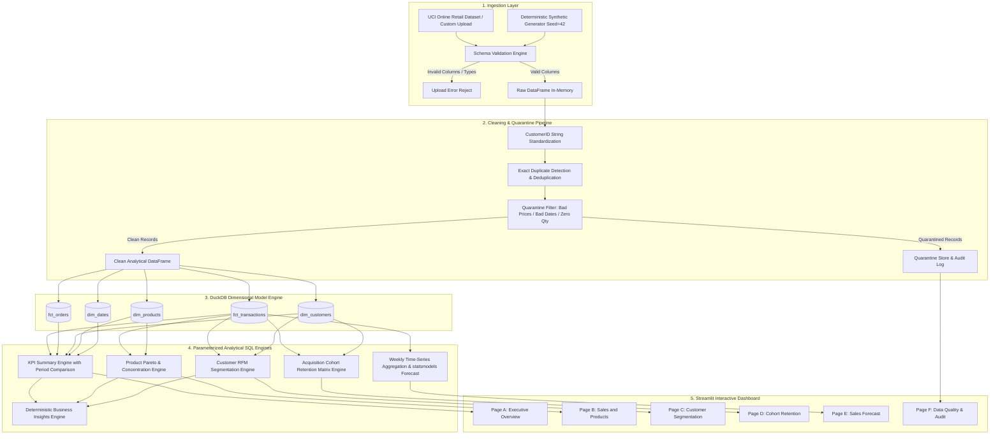

# RetailPulse - Data Lineage & Technical Architecture

## 1. System Architecture Overview

RetailPulse uses a modular data engineering and analytics architecture designed for full reproducibility, local execution (zero API keys or external services), and sub-second analytical query performance using DuckDB.

---

## 2. Ingestion & Transformation Details

### A. Raw Ingestion (`src/ingestion.py`)
- Standardizes incoming column headers case-insensitively to matching target columns:
  `InvoiceNo, StockCode, Description, Quantity, InvoiceDate, UnitPrice, CustomerID, Country`.
- Rejects files missing required fields with descriptive error notifications.
- Generates a 24-month deterministic synthetic demo dataset with repeat customers, seasonal peaks, cancellations, and intentional data flaws.

### B. Cleaning Pipeline (`src/cleaning.py`)
1. **CustomerID Formatting**: Float numbers like `17850.0` are stripped and preserved as strings (`'17850'`). Empty strings or `'nan'` strings are converted to `None`.
2. **Duplicate Deduplication**: Identifies exact duplicate rows across all original fields. Logs the count and retains the first occurrence to avoid artificial transaction inflation.
3. **Quarantine Routing**: Records with `UnitPrice <= 0`, invalid dates, or `Quantity == 0` are routed into `quarantine_df` with an explicit human-readable reason string.
4. **Cancellation Isolation**: Invoices starting with `'C'` and negative quantities are categorized as returns. Positive sales rows are restricted to `not is_return and quantity > 0 and unit_price > 0`.
5. **Guest Checkout Isolation**: Rows where `customer_id IS NULL` are retained for top-line revenue, volume, and product analysis, but flagged with `has_customer_id = False` to prevent distorting customer retention and RFM metrics.

---

## 3. Dimensional Model & SQL Execution

### DuckDB In-Memory Integration (`src/database.py`)
- Tables are defined via `sql/schema.sql`.
- DuckDB executes all aggregation logic in-memory with C++ vectorized speed.
- Filter parameters (`$start_date`, `$end_date`, `$country`) are passed safely via DuckDB's parameterized interface, preventing SQL injection vulnerabilities.

---

## 4. Analytical Modules
- **KPI Metrics (`src/metrics.py`)**: Computes Gross Sales, Return Value, Net Revenue, Orders, AOV, Purchasing Customers, Repeat Purchase Rate, and Units. Evaluates period-over-period delta against preceding equal-length window.
- **RFM Segmentation (`src/segmentation.py`)**: Quantile scoring with rank-based tie-breaking. Reference date defaults to `end_date + 1 day` (never today's date).
- **Cohort Retention (`src/cohorts.py`)**: Acquisition cohort determined from customer's first observed purchase across the full dataset. Future periods are preserved as `NaN` (blank).
- **Forecasting (`src/forecasting.py`)**: Aggregates weekly series, detects partial boundary weeks, performs chronological holdout (last 4 weeks), benchmarks Exponential Smoothing against Naive Moving Average, and computes MAE/WAPE.
- **Business Insights (`src/insights.py`)**: Deterministic 5-part rule-based insight generation (Observation, Comparison, Cautious Interpretation, Action, Limitation).
